I'm Gonzalo, a full-stack developer working with **C#, .NET and databases**. I also build games in **Unity**, where I prototype combat and gameplay systems inspired by RPGs and MMOs.

## Games

- [Houston, I have no idea](https://batzzer.itch.io/houston-i-have-no-idea) — interactive fiction made for Brackeys Game Jam.
- [The Hero’s Journey](https://batzzer.itch.io/the-heros-journey) — a platformer with beat ’em up combat.
- [Quark GameJam No. 2](https://github.com/xBatzzer/Quark-GameJam-N-2) — source code for a C# game jam project.

[Watch a gameplay clip](./assets/giftest.gif)

## Software & experiments

- [GoF Design Patterns](https://github.com/xBatzzer/Patrones-de-dise-os-GOF) — design pattern examples in C#.
- [Pokémon Quiz](https://github.com/xBatzzer/pokemon-quiz) — a quiz built with Angular and TypeScript.
- [Shadow Duels](https://ocg.batzcraft.com/) — a fan project for card duels and deck building.

## Toolbox

| Area | Tools |
| --- | --- |
| Game development | Unity · C# · Blender |
| Backend & data | .NET · SQL Server · Docker |
| Web | TypeScript · React · Angular · Three.js |
| Version control | Git |
