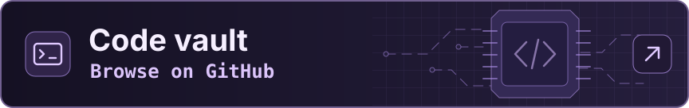

## Hi, I'm Gonzalo

**Full-stack developer · Game developer**

> Full-stack **.NET** development with **C#** and **SQL Server**.
>
> In **Unity**, I prototype **combat systems** and **gameplay mechanics** inspired by **RPGs and MMOs**.

## Games

## Software & experiments

